# Laboratorio 3 de Criptografía y Seguridad en Redes

Francisco Antonio Tapia Canales · CIT2113 · Sección 4 · Profesor Brayan Espina.
Correo: francisco.tapia1@mail.udp.cl.
Práctica realizada el 22 de octubre de 2026 en una cuenta propia de ForoDVD.

Repositorio: https://github.com/rkkas/laboratorio3-forodvd

El registro y el inicio de sesión enviaron MD5 calculado en el navegador.
El control con contraseña incorrecta fue rechazado. Al sustituir sus dos hashes por el MD5 correcto, se abrió una sesión con la cuenta de prueba.

## Informe y revisión

- [Informe PDF](informe/Informe_Laboratorio_3.pdf)
- [Fuente LaTeX](informe/lab03_informe.tex)
- [Verificación de los siete criterios de la rúbrica](docs/RUBRICA.md)
- [Procedimiento y resultados](docs/PROCEDIMIENTO.md)
- [Fuentes públicas](docs/FUENTES.md)

## Evidencias

### 2.1 Registro

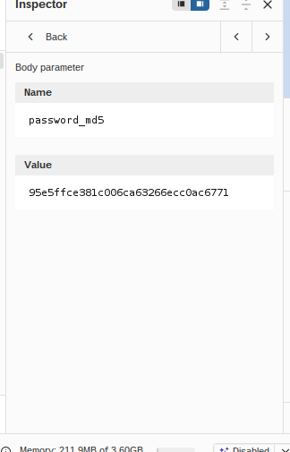
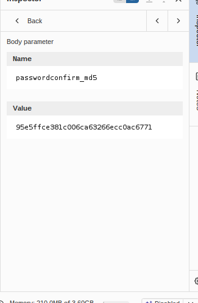

### 2.2 Inicio de sesión

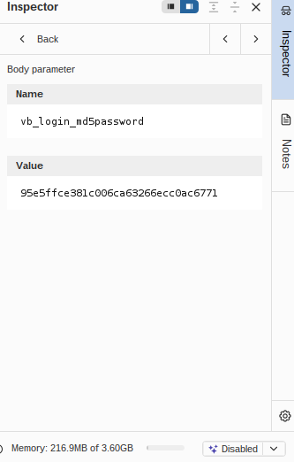
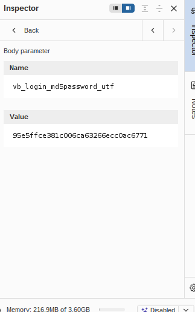

### 2.3 Consola del navegador

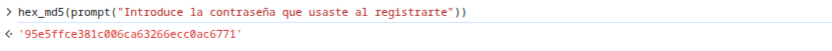

### 2.4 Interceptación de login

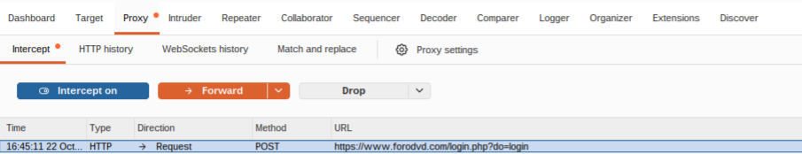
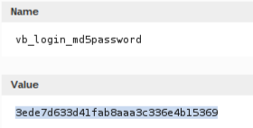

### 2.5 Acceso mediante sustitución del hash

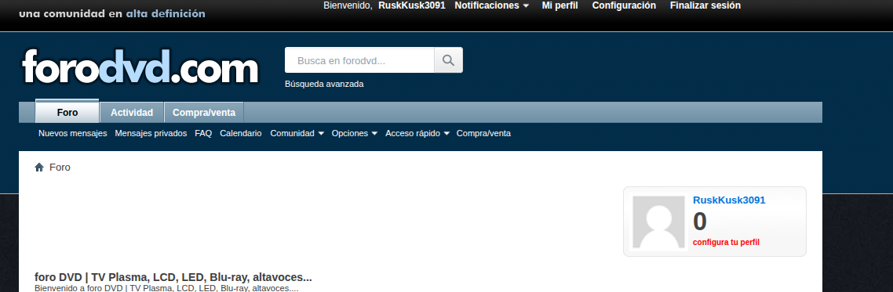
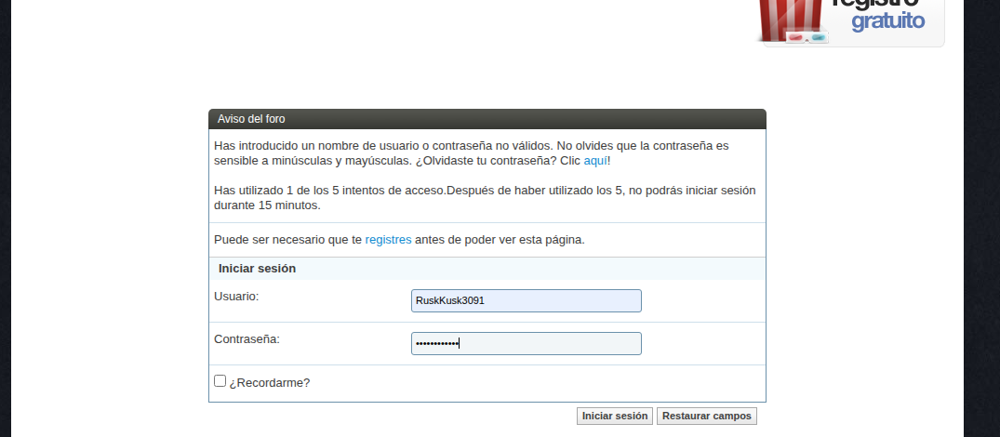
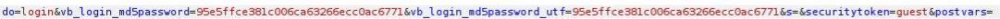
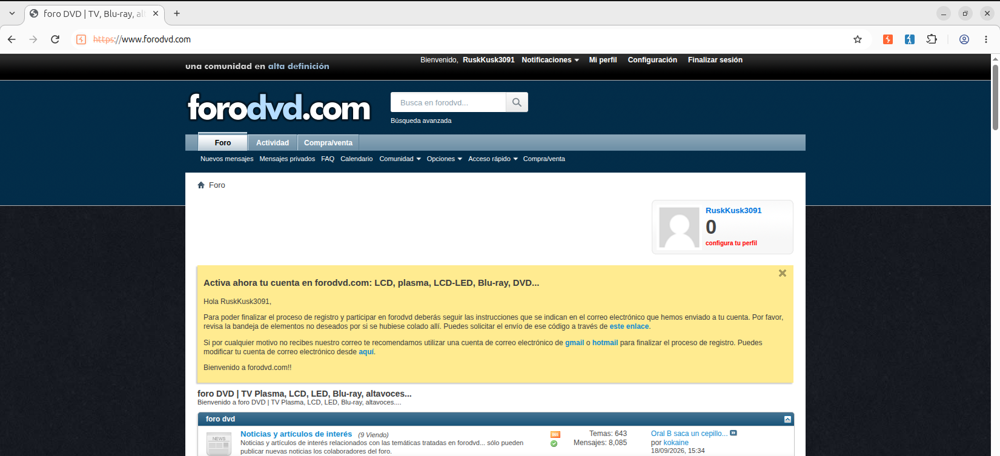

### Cierre con cambio de contraseña

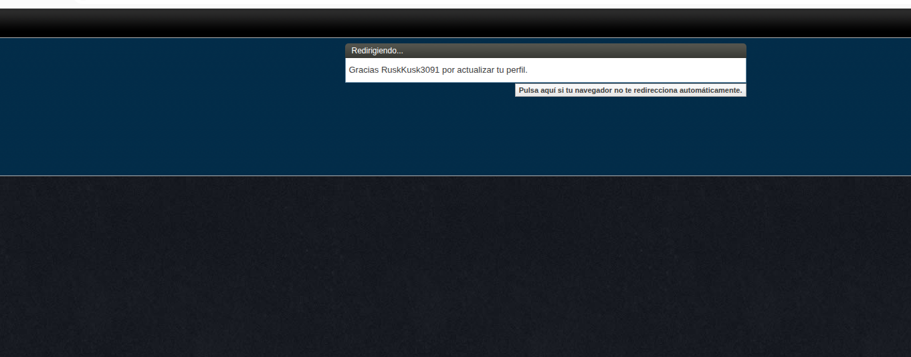

Los originales completos permanecen fuera del repositorio. Los archivos entregables incluyen únicamente las capturas seleccionadas y los recortes necesarios.

## Archivos de apoyo

- scripts/hash_en_consola.js contiene el comando usado en la consola de ForoDVD.
- evidencias/manifest.json registra las huellas SHA-256 de las imágenes.
- evidencias/procedencia_recortes.json identifica el origen y el rectángulo de cada recorte.

## Compilar la fuente

Desde la raíz del repositorio, con una instalación de LaTeX:

    pdflatex -interaction=nonstopmode -halt-on-error -output-directory=informe -jobname=Informe_Laboratorio_3 informe/lab03_informe.tex
    pdflatex -interaction=nonstopmode -halt-on-error -output-directory=informe -jobname=Informe_Laboratorio_3 informe/lab03_informe.tex

El PDF de entrega se compila directamente desde esta fuente LaTeX. Las dos pasadas actualizan el índice y los enlaces. Se deben conservar las carpetas `informe/` y `evidencias/` al compilar.

## Alcance

La cuenta permaneció pendiente de activación por correo para participar.
La práctica demuestra la reutilización del hash en el flujo probado y no permite inferir el almacenamiento interno del servidor.
El cambio de contraseña se envió al finalizar y el sitio confirmó la actualización.
